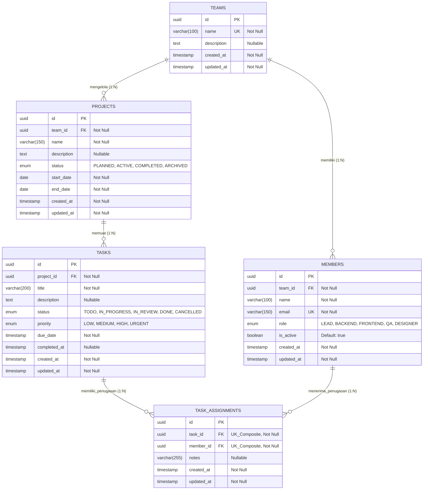

# Dokumentasi Rancangan & Arsitektur Sistem
## Studi Kasus 4 — Task Management System

| Informasi Dokumen | Detail Spesifikasi |
| :--- | :--- |
| **Nama Sistem** | Task Management System (Pengelolaan Proyek & Tugas Tim) |
| **Framework Backend** | NestJS (Node.js / TypeScript) |
| **ORM & Database** | TypeORM dengan PostgreSQL / MySQL |
| **Pola Arsitektur** | Modular Layered Architecture (Controller - Service - Repository) |
| **Tingkat Normalisasi** | Third Normal Form (3NF) |

---

## Daftar Isi
1. [Rencana Pengerjaan Proyek (Work Breakdown Structure)](#1-rencana-pengerjaan-proyek-work-breakdown-structure)
2. [Prinsip Normalisasi dan Integritas Data](#2-prinsip-normalisasi-dan-integritas-data)
3. [Standar Atribut Dasar Entitas TypeORM (`BaseEntity`)](#3-standar-atribut-dasar-entitas-typeorm-baseentity)
4. [Struktur Lengkap Tabel, Penjelasan, dan Contoh Kasus](#4-struktur-lengkap-tabel-penjelasan-dan-contoh-kasus)
5. [Ringkasan Relasi Antar Tabel](#5-ringkasan-relasi-antar-tabel)
6. [Diagram Relasi Entitas (ERD)](#6-diagram-relasi-entitas-erd)
7. [Aturan Bisnis (Business Rules) & State Machine](#7-aturan-bisnis-business-rules--state-machine)
8. [Implementasi Kode Entitas TypeORM](#8-implementasi-kode-entitas-typeorm)

---

## 1. Rencana Pengerjaan Proyek (Work Breakdown Structure)

Pengembangan backend dibagi ke dalam 5 fase terstruktur untuk memastikan fondasi basis data dan aturan bisnis tervalidasi dengan baik:

| Fase | Nama Tahapan | Aktivitas & Deliverable Utama |
| :---: | :--- | :--- |
| **Fase 1** | **Inisialisasi & Konfigurasi** | - Setup proyek menggunakan NestJS CLI (`@nestjs/cli`).<br>- Instalasi `@nestjs/typeorm`, `typeorm`, `pg`/`mysql2`, `class-validator`, dan `class-transformer`.<br>- Konfigurasi koneksi database melalui `@nestjs/config` (`.env`). |
| **Fase 2** | **Pemodelan Data & Migrasi** | - Pembuatan kelas abstrak `BaseEntity` untuk keseragaman atribut dasar.<br>- Implementasi 5 entitas utama (`Team`, `Member`, `Project`, `Task`, `TaskAssignment`).<br>- Pengaturan indeks, *enum*, dan *unique constraint* serta eksekusi migrasi TypeORM. |
| **Fase 3** | **Pengembangan Modul Master** | - Pembuatan modul, DTO, Service, dan Controller untuk `Teams`, `Members`, dan `Projects`.<br>- Penerapan validasi rentang tanggal proyek (`start_date` $\le$ `end_date`) dan keunikan email anggota. |
| **Fase 4** | **Pengembangan Modul Tugas & Penugasan** | - Implementasi CRUD `Tasks` di dalam proyek.<br>- Implementasi *state machine* status tugas dan manajemen tenggat waktu (`due_date`).<br>- Implementasi endpoint penugasan anggota (`TaskAssignments`) dengan validasi lintas tim. |
| **Fase 5** | **Pengujian & Dokumentasi API** | - Pengujian skenario positif dan negatif (validasi error `400 Bad Request`, `404 Not Found`, `409 Conflict`).<br>- Penyusunan dokumentasi endpoint menggunakan Swagger (`@nestjs/swagger`) atau Postman Collection. |

---

## 2. Prinsip Normalisasi dan Integritas Data

### A. Pemenuhan Prinsip Normalisasi (Hingga 3NF)
* **First Normal Form (1NF — Nilai Atomik):** Setiap kolom pada seluruh tabel hanya menyimpan satu nilai tunggal (atomik). Daftar anggota yang mengerjakan suatu tugas tidak disimpan sebagai *array* atau string koma di dalam tabel `tasks`, melainkan dipisahkan ke tabel tersendiri.
* **Second Normal Form (2NF — Ketergantungan Fungsional Penuh):** Relasi *Many-to-Many* antara `tasks` dan `members` diuraikan melalui tabel penghubung (`task_assignments`). Atribut spesifik penugasan (seperti waktu penugasan dan catatan peran) bergantung penuh pada kombinasi tugas dan anggota terkait.
* **Third Normal Form (3NF — Tanpa Ketergantungan Transitif):** Tidak ada duplikasi kolom yang dapat diturunkan dari tabel lain. Sebagai contoh, tabel `tasks` tidak menyimpan kolom `team_id` karena identitas tim pemilik tugas sudah dapat ditelusuri secara pasti melalui relasi `tasks.project_id` $\rightarrow$ `projects.team_id`.

### B. Penjagaan Integritas Data
1. **Integritas Entitas (Entity Integrity):** Seluruh tabel wajib memiliki *Primary Key* bertipe `UUID v4` yang dibangkitkan secara otomatis oleh TypeORM (`@PrimaryGeneratedColumn('uuid')`), mencegah nilai `NULL` atau duplikasi identitas baris.
2. **Integritas Referensial (Referential Integrity):** Seluruh *Foreign Key* dijaga pada level basis data dengan aturan `ON DELETE RESTRICT` untuk entitas master (`teams`, `members`) agar riwayat tidak hilang secara tidak sengaja, serta `ON DELETE CASCADE` untuk entitas anak langsung (`tasks` terhadap `projects`, `task_assignments` terhadap `tasks`).
3. **Integritas Domain & Unik (Domain & Unique Integrity):**
   - Penggunaan tipe `ENUM` untuk membatasi input status dan prioritas.
   - Penerapan `@Unique(['taskId', 'memberId'])` pada tabel `task_assignments` agar seorang anggota tidak dapat ditugaskan dua kali pada tugas yang sama.

---

## 3. Standar Atribut Dasar Entitas TypeORM (`BaseEntity`)

Seluruh tabel dalam rancangan ini mewarisi kelas abstrak `BaseEntity` dari TypeORM untuk menjamin konsistensi pencatatan identitas dan jejak waktu (*audit trail*) di setiap tabel:

| Nama Kolom | Dekorator TypeORM | Tipe Data DB | Keterangan |
| :--- | :--- | :--- | :--- |
| `id` | `@PrimaryGeneratedColumn('uuid')` | `uuid` | Kunci utama unik untuk setiap baris data. |
| `created_at` | `@CreateDateColumn({ type: 'timestamp' })` | `timestamp` | Waktu baris data pertama kali dibuat (otomatis). |
| `updated_at` | `@UpdateDateColumn({ type: 'timestamp' })` | `timestamp` | Waktu baris data terakhir kali diperbarui (otomatis). |

---

## 4. Struktur Lengkap Tabel, Penjelasan, dan Contoh Kasus

### 4.1. Tabel `teams` (Entitas `TeamEntity`)
Menyimpan data kelompok kerja atau divisi yang menaungi anggota dan proyek.

| Nama Atribut | Tipe Data | Constraint & Dekorator TypeORM | Keterangan |
| :--- | :--- | :--- | :--- |
| `id` | `uuid` | `PK`, `NOT NULL`, `@PrimaryGeneratedColumn('uuid')` | Identitas unik tim (warisan `BaseEntity`). |
| `name` | `varchar(100)` | `UNIQUE`, `NOT NULL`, `@Column({ length: 100, unique: true })` | Nama resmi tim kerja. |
| `description` | `text` | `NULLABLE`, `@Column({ type: 'text', nullable: true })` | Penjelasan fungsi atau fokus tim. |
| `created_at` | `timestamp` | `NOT NULL`, `@CreateDateColumn()` | Waktu pembuatan data tim. |
| `updated_at` | `timestamp` | `NOT NULL`, `@UpdateDateColumn()` | Waktu pembaruan terakhir data tim. |

> **Catatan Tipe & Relasi:**
> - **Tipe Data:** `name` dibatasi `varchar(100)` dengan constraint `UNIQUE` agar tidak ada dua tim dengan nama identik. `description` menggunakan `text` karena panjang deskripsi bersifat fleksibel.
> - **Relasi:** Merupakan *Parent Table* murni. Memiliki dua relasi `@OneToMany()` menuju `ProjectEntity` (satu tim mengelola banyak proyek) dan `MemberEntity` (satu tim memiliki banyak anggota).
> - **Contoh Real-Case:** Perusahaan membuat tim bernama **"Core Platform Squad"** yang bertugas membangun dan memelihara infrastruktur layanan pembayaran dan autentikasi.

---

### 4.2. Tabel `members` (Entitas `MemberEntity`)
Menyimpan daftar individu/anggota yang tergabung di dalam suatu tim.

| Nama Atribut | Tipe Data | Constraint & Dekorator TypeORM | Keterangan |
| :--- | :--- | :--- | :--- |
| `id` | `uuid` | `PK`, `NOT NULL`, `@PrimaryGeneratedColumn('uuid')` | Identitas unik anggota. |
| `team_id` | `uuid` | `FK`, `NOT NULL`, `@Column({ type: 'uuid' })` | Referensi ke `teams.id`. |
| `name` | `varchar(100)` | `NOT NULL`, `@Column({ length: 100 })` | Nama lengkap anggota tim. |
| `email` | `varchar(150)` | `UNIQUE`, `NOT NULL`, `@Column({ length: 150, unique: true })` | Alamat email kerja unik anggota. |
| `role` | `enum` | `NOT NULL`, `@Column({ type: 'enum', enum: MemberRole })` | Peran anggota (`LEAD`, `BACKEND`, `FRONTEND`, `QA`, `DESIGNER`). |
| `is_active` | `boolean` | `NOT NULL`, `DEFAULT true`, `@Column({ default: true })` | Status keaktifan anggota dalam menerima tugas. |
| `created_at` | `timestamp` | `NOT NULL`, `@CreateDateColumn()` | Waktu anggota didaftarkan. |
| `updated_at` | `timestamp` | `NOT NULL`, `@UpdateDateColumn()` | Waktu pembaruan data anggota. |

> **Catatan Tipe & Relasi:**
> - **Tipe Data:** Menggunakan `is_active` (`boolean`) sebagai mekanisme *soft-deactivation* agar anggota yang sudah pindah/keluar tidak perlu dihapus dari database sehingga riwayat penugasan lama tetap terjaga.
> - **Relasi:** Memiliki relasi `@ManyToOne()` ke `TeamEntity` (banyak anggota dimiliki oleh satu tim) dan `@OneToMany()` ke `TaskAssignmentEntity` (satu anggota dapat menerima banyak penugasan).
> - **Contoh Real-Case:** **Raka Pratama** (`raka@company.com`) didaftarkan sebagai `BACKEND` di dalam tim **"Core Platform Squad"** dengan status `is_active = true`.

---

### 4.3. Tabel `projects` (Entitas `ProjectEntity`)
Menyimpan daftar proyek yang dikerjakan oleh suatu tim dalam periode waktu tertentu.

| Nama Atribut | Tipe Data | Constraint & Dekorator TypeORM | Keterangan |
| :--- | :--- | :--- | :--- |
| `id` | `uuid` | `PK`, `NOT NULL`, `@PrimaryGeneratedColumn('uuid')` | Identitas unik proyek. |
| `team_id` | `uuid` | `FK`, `NOT NULL`, `@Column({ type: 'uuid' })` | Referensi ke `teams.id` pemilik proyek. |
| `name` | `varchar(150)` | `NOT NULL`, `@Column({ length: 150 })` | Nama proyek yang dikerjakan. |
| `description` | `text` | `NULLABLE`, `@Column({ type: 'text', nullable: true })` | Detail ruang lingkup dan tujuan proyek. |
| `status` | `enum` | `NOT NULL`, `DEFAULT 'PLANNED'`, `@Column({ type: 'enum' })` | Nilai: `PLANNED`, `ACTIVE`, `COMPLETED`, `ARCHIVED`. |
| `start_date` | `date` | `NOT NULL`, `@Column({ type: 'date' })` | Tanggal dimulainya proyek. |
| `end_date` | `date` | `NOT NULL`, `@Column({ type: 'date' })` | Target tanggal selesai proyek. |
| `created_at` | `timestamp` | `NOT NULL`, `@CreateDateColumn()` | Waktu pembuatan proyek. |
| `updated_at` | `timestamp` | `NOT NULL`, `@UpdateDateColumn()` | Waktu pembaruan terakhir proyek. |

> **Catatan Tipe & Relasi:**
> - **Tipe Data:** `start_date` dan `end_date` menggunakan tipe `date` (tanpa jam) karena jadwal tingkat proyek dihitung dalam satuan hari kalender.
> - **Relasi:** Memiliki relasi `@ManyToOne()` ke `TeamEntity` dan `@OneToMany()` ke `TaskEntity` (satu proyek memuat banyak tugas).
> - **Contoh Real-Case:** Tim **"Core Platform Squad"** membuat proyek **"Payment Gateway v2"** dengan status `ACTIVE` mulai tanggal `2026-11-01` hingga `2026-12-31`.

---

### 4.4. Tabel `tasks` (Entitas `TaskEntity`)
Menyimpan butir pekerjaan spesifik pada suatu proyek beserta status dan tenggat waktunya.

| Nama Atribut | Tipe Data | Constraint & Dekorator TypeORM | Keterangan |
| :--- | :--- | :--- | :--- |
| `id` | `uuid` | `PK`, `NOT NULL`, `@PrimaryGeneratedColumn('uuid')` | Identitas unik tugas. |
| `project_id` | `uuid` | `FK`, `NOT NULL`, `@Column({ type: 'uuid' })` | Referensi ke `projects.id`. |
| `title` | `varchar(200)` | `NOT NULL`, `@Column({ length: 200 })` | Judul singkat tugas. |
| `description` | `text` | `NULLABLE`, `@Column({ type: 'text', nullable: true })` | Spesifikasi teknis dan *acceptance criteria*. |
| `status` | `enum` | `NOT NULL`, `DEFAULT 'TODO'`, `@Column({ type: 'enum' })` | Nilai: `TODO`, `IN_PROGRESS`, `IN_REVIEW`, `DONE`, `CANCELLED`. |
| `priority` | `enum` | `NOT NULL`, `DEFAULT 'MEDIUM'`, `@Column({ type: 'enum' })` | Nilai: `LOW`, `MEDIUM`, `HIGH`, `URGENT`. |
| `due_date` | `timestamp` | `NOT NULL`, `@Column({ type: 'timestamp' })` | Batas waktu (tanggal & jam) penyelesaian tugas. |
| `completed_at` | `timestamp` | `NULLABLE`, `@Column({ type: 'timestamp', nullable: true })` | Diisi otomatis saat status berubah menjadi `DONE`. |
| `created_at` | `timestamp` | `NOT NULL`, `@CreateDateColumn()` | Waktu pembuatan tugas. |
| `updated_at` | `timestamp` | `NOT NULL`, `@UpdateDateColumn()` | Waktu pembaruan terakhir tugas. |

> **Catatan Tipe & Relasi:**
> - **Tipe Data:** Berbeda dengan proyek, `due_date` pada tugas menggunakan `timestamp` agar tenggat waktu bisa ditetapkan secara presisi hingga jam tertentu (misal pukul `17:00`).
> - **Relasi:** Memiliki relasi `@ManyToOne()` ke `ProjectEntity` (dengan `onDelete: 'CASCADE'`) dan `@OneToMany()` ke `TaskAssignmentEntity`.
> - **Contoh Real-Case:** Pada proyek **"Payment Gateway v2"**, dibuat tugas **"Implementasi Verifikasi Signature Webhook QRIS"** dengan prioritas `HIGH`, status `IN_PROGRESS`, dan tenggat `2026-11-15 17:00:00`.

---

### 4.5. Tabel `task_assignments` (Entitas `TaskAssignmentEntity`)
Tabel penghubung (*junction table*) yang mencatat penugasan satu atau beberapa anggota pada suatu tugas.

| Nama Atribut | Tipe Data | Constraint & Dekorator TypeORM | Keterangan |
| :--- | :--- | :--- | :--- |
| `id` | `uuid` | `PK`, `NOT NULL`, `@PrimaryGeneratedColumn('uuid')` | Identitas unik baris penugasan. |
| `task_id` | `uuid` | `FK`, `NOT NULL`, `@Column({ type: 'uuid' })` | Referensi ke `tasks.id`. |
| `member_id` | `uuid` | `FK`, `NOT NULL`, `@Column({ type: 'uuid' })` | Referensi ke `members.id`. |
| `notes` | `varchar(255)` | `NULLABLE`, `@Column({ length: 255, nullable: true })` | Catatan peran/tanggung jawab spesifik pada tugas ini. |
| `created_at` | `timestamp` | `NOT NULL`, `@CreateDateColumn()` | Waktu anggota ditugaskan (`assigned_at`). |
| `updated_at` | `timestamp` | `NOT NULL`, `@UpdateDateColumn()` | Waktu pembaruan catatan penugasan. |

> **Catatan Tipe & Relasi:**
> - **Tipe Data & Constraint:** Menggunakan dekorator kelas `@Unique(['taskId', 'memberId'])`. Kombinasi ini memastikan satu tugas dapat dikerjakan banyak anggota, tetapi anggota yang sama tidak dapat dimasukkan dua kali di tugas yang sama.
> - **Relasi:** Mengubah relasi konseptual *Many-to-Many* menjadi dua relasi fisik `@ManyToOne()` menuju `TaskEntity` dan `MemberEntity`.
> - **Contoh Real-Case:** Tugas **"Implementasi Verifikasi Signature Webhook QRIS"** ditugaskan kepada **Raka Pratama** (catatan: *"Coding endpoint"*) dan **Dina Lestari** (catatan: *"Pengujian skenario webhook"*), menghasilkan 2 baris di tabel `task_assignments`.

---

## 5. Ringkasan Relasi Antar Tabel

| Parent Table | Child Table | Kardinalitas | Foreign Key (di Child) | Dekorator TypeORM | Aturan `ON DELETE` | Keterangan Relasi |
| :--- | :--- | :---: | :--- | :--- | :---: | :--- |
| `teams` | `projects` | $1 : N$ | `projects.team_id` | `@OneToMany` / `@ManyToOne` | `RESTRICT` | Satu tim memiliki banyak proyek; tim tidak bisa dihapus jika masih ada proyek. |
| `teams` | `members` | $1 : N$ | `members.team_id` | `@OneToMany` / `@ManyToOne` | `RESTRICT` | Satu tim memiliki banyak anggota; tim tidak bisa dihapus jika masih ada anggota. |
| `projects` | `tasks` | $1 : N$ | `tasks.project_id` | `@OneToMany` / `@ManyToOne` | `CASCADE` | Satu proyek memiliki banyak tugas; jika proyek dihapus, seluruh tugasnya ikut terhapus. |
| `tasks` | `task_assignments` | $1 : N$ | `task_assignments.task_id` | `@OneToMany` / `@ManyToOne` | `CASCADE` | Satu tugas memiliki banyak penugasan; jika tugas dihapus, data penugasannya ikut terhapus. |
| `members` | `task_assignments` | $1 : N$ | `task_assignments.member_id` | `@OneToMany` / `@ManyToOne` | `RESTRICT` | Satu anggota menerima banyak penugasan; anggota yang punya riwayat tugas tidak boleh dihapus fisik. |

---

## 6. Diagram Relasi Entitas (ERD)

### A. Visualisasi Mermaid ERD
*(Dapat dirender langsung pada peninjau Markdown yang mendukung Mermaid)*



### B. Skema Teks (ASCII Diagram)

```text
+-----------------------+          +-----------------------+          +-----------------------+
|         TEAMS         |          |       PROJECTS        |          |         TASKS         |
+-----------------------+          +-----------------------+          +-----------------------+
| PK id (uuid)          | 1      * | PK id (uuid)          | 1      * | PK id (uuid)          |
| UK name               |----------| FK team_id (uuid)     |----------| FK project_id (uuid)  |
|    description        |          |    name               |          |    title              |
|    created_at         |          |    description        |          |    description        |
|    updated_at         |          |    status (enum)      |          |    status (enum)      |
+-----------------------+          |    start_date         |          |    priority (enum)    |
            | 1                    |    end_date           |          |    due_date           |
            |                      |    created_at         |          |    completed_at       |
            |                      |    updated_at         |          |    created_at         |
            | *                    +-----------------------+          |    updated_at         |
+-----------------------+                                             +-----------------------+
|        MEMBERS        |                                                         | 1
+-----------------------+                                                         |
| PK id (uuid)          |                                                         | *
| FK team_id (uuid)     |                                             +-----------------------+
|    name               | 1                                         * |   TASK_ASSIGNMENTS    |
| UK email              |---------------------------------------------|-----------------------|
|    role (enum)        |                                             | PK id (uuid)          |
|    is_active (bool)   |                                             | FK task_id (uuid)  [U]|
|    created_at         |                                             | FK member_id (uuid)[U]|
|    updated_at         |                                             |    notes              |
+-----------------------+                                             |    created_at         |
                                                                      |    updated_at         |
                                                                      +-----------------------+
```

---

## 7. Aturan Bisnis (Business Rules) & State Machine

Untuk memenuhi spesifikasi studi kasus, Service Layer di NestJS menerapkan aturan bisnis berikut:

### A. Aturan Pengelolaan Status & Tenggat Waktu Tugas
1. **Validasi Rentang Tenggat Waktu (`due_date`):**
   - Tenggat waktu tugas wajib berada di dalam periode proyek induknya:
     $$\text{Project.start\_date} \le \text{Task.due\_date} \le \text{Project.end\_date}$$
   - Pembuatan atau pengubahan tugas hanya diizinkan apabila status proyek induk adalah `PLANNED` atau `ACTIVE` (ditolak jika `COMPLETED` atau `ARCHIVED`).
2. **Transisi Status Tugas (State Machine):**
   - `TODO` $\rightarrow$ `IN_PROGRESS` atau `CANCELLED`
   - `IN_PROGRESS` $\rightarrow$ `IN_REVIEW`, `TODO`, atau `CANCELLED`
   - `IN_REVIEW` $\rightarrow$ `DONE` atau `IN_PROGRESS` (jika butuh perbaikan)
   - `DONE` & `CANCELLED` bersifat **Final** (tidak dapat diubah ke status lain).
3. **Syarat Minimal Penugasan saat Pengerjaan:**
   - Tugas **tidak dapat** diubah ke status `IN_PROGRESS`, `IN_REVIEW`, atau `DONE` jika belum memiliki minimal 1 anggota yang ditugaskan di tabel `task_assignments`.
4. **Pencatatan Waktu Selesai Otomatis:**
   - Saat status tugas berubah menjadi `DONE`, sistem otomatis mengisi kolom `completed_at` dengan waktu server saat ini (`new Date()`).

### B. Aturan Penugasan Anggota (`TaskAssignments`)
1. **Validasi Satu Tim (Same-Team Policy):**
   - Anggota yang ditugaskan ke suatu tugas **wajib berasal dari tim yang sama** dengan proyek induk dari tugas tersebut:
     $$\text{Member.team\_id} = \text{Task.project.team\_id}$$
   - Jika anggota berasal dari tim berbeda, kembalikan `400 Bad Request`.
2. **Validasi Status Keaktifan Anggota:**
   - Anggota dengan `is_active = false` tidak dapat ditambahkan ke penugasan tugas baru.
3. **Kunci Penugasan pada Tugas Final:**
   - Penambahan atau pencabutan anggota pada tugas yang sudah berstatus `DONE` atau `CANCELLED` ditolak oleh sistem.

---

## 8. Implementasi Kode Entitas TypeORM

Berikut adalah implementasi kode TypeScript untuk `BaseEntity` dan kelima entitas utama di NestJS:

```typescript
// src/common/entities/base.entity.ts
import { PrimaryGeneratedColumn, CreateDateColumn, UpdateDateColumn } from 'typeorm';

export abstract class BaseEntity {
  @PrimaryGeneratedColumn('uuid')
  id: string;

  @CreateDateColumn({ name: 'created_at', type: 'timestamp' })
  createdAt: Date;

  @UpdateDateColumn({ name: 'updated_at', type: 'timestamp' })
  updatedAt: Date;
}
```

```typescript
// src/database/entities/task-management.entities.ts
import { Entity, Column, ManyToOne, OneToMany, JoinColumn, Unique } from 'typeorm';
import { BaseEntity } from '../../common/entities/base.entity';

export enum MemberRole {
  LEAD = 'LEAD',
  BACKEND = 'BACKEND',
  FRONTEND = 'FRONTEND',
  QA = 'QA',
  DESIGNER = 'DESIGNER',
}

export enum ProjectStatus {
  PLANNED = 'PLANNED',
  ACTIVE = 'ACTIVE',
  COMPLETED = 'COMPLETED',
  ARCHIVED = 'ARCHIVED',
}

export enum TaskStatus {
  TODO = 'TODO',
  IN_PROGRESS = 'IN_PROGRESS',
  IN_REVIEW = 'IN_REVIEW',
  DONE = 'DONE',
  CANCELLED = 'CANCELLED',
}

export enum TaskPriority {
  LOW = 'LOW',
  MEDIUM = 'MEDIUM',
  HIGH = 'HIGH',
  URGENT = 'URGENT',
}

@Entity('teams')
export class TeamEntity extends BaseEntity {
  @Column({ type: 'varchar', length: 100, unique: true })
  name: string;

  @Column({ type: 'text', nullable: true })
  description: string | null;

  @OneToMany(() => MemberEntity, (member) => member.team)
  members: MemberEntity[];

  @OneToMany(() => ProjectEntity, (project) => project.team)
  projects: ProjectEntity[];
}

@Entity('members')
export class MemberEntity extends BaseEntity {
  @Column({ name: 'team_id', type: 'uuid' })
  teamId: string;

  @Column({ type: 'varchar', length: 100 })
  name: string;

  @Column({ type: 'varchar', length: 150, unique: true })
  email: string;

  @Column({ type: 'enum', enum: MemberRole, default: MemberRole.BACKEND })
  role: MemberRole;

  @Column({ name: 'is_active', type: 'boolean', default: true })
  isActive: boolean;

  @ManyToOne(() => TeamEntity, (team) => team.members, { onDelete: 'RESTRICT' })
  @JoinColumn({ name: 'team_id' })
  team: TeamEntity;

  @OneToMany(() => TaskAssignmentEntity, (assignment) => assignment.member)
  assignments: TaskAssignmentEntity[];
}

@Entity('projects')
export class ProjectEntity extends BaseEntity {
  @Column({ name: 'team_id', type: 'uuid' })
  teamId: string;

  @Column({ type: 'varchar', length: 150 })
  name: string;

  @Column({ type: 'text', nullable: true })
  description: string | null;

  @Column({ type: 'enum', enum: ProjectStatus, default: ProjectStatus.PLANNED })
  status: ProjectStatus;

  @Column({ name: 'start_date', type: 'date' })
  startDate: string;

  @Column({ name: 'end_date', type: 'date' })
  endDate: string;

  @ManyToOne(() => TeamEntity, (team) => team.projects, { onDelete: 'RESTRICT' })
  @JoinColumn({ name: 'team_id' })
  team: TeamEntity;

  @OneToMany(() => TaskEntity, (task) => task.project)
  tasks: TaskEntity[];
}

@Entity('tasks')
export class TaskEntity extends BaseEntity {
  @Column({ name: 'project_id', type: 'uuid' })
  projectId: string;

  @Column({ type: 'varchar', length: 200 })
  title: string;

  @Column({ type: 'text', nullable: true })
  description: string | null;

  @Column({ type: 'enum', enum: TaskStatus, default: TaskStatus.TODO })
  status: TaskStatus;

  @Column({ type: 'enum', enum: TaskPriority, default: TaskPriority.MEDIUM })
  priority: TaskPriority;

  @Column({ name: 'due_date', type: 'timestamp' })
  dueDate: Date;

  @Column({ name: 'completed_at', type: 'timestamp', nullable: true })
  completedAt: Date | null;

  @ManyToOne(() => ProjectEntity, (project) => project.tasks, { onDelete: 'CASCADE' })
  @JoinColumn({ name: 'project_id' })
  project: ProjectEntity;

  @OneToMany(() => TaskAssignmentEntity, (assignment) => assignment.task)
  assignments: TaskAssignmentEntity[];
}

@Entity('task_assignments')
@Unique('uq_task_member', ['taskId', 'memberId'])
export class TaskAssignmentEntity extends BaseEntity {
  @Column({ name: 'task_id', type: 'uuid' })
  taskId: string;

  @Column({ name: 'member_id', type: 'uuid' })
  memberId: string;

  @Column({ type: 'varchar', length: 255, nullable: true })
  notes: string | null;

  @ManyToOne(() => TaskEntity, (task) => task.assignments, { onDelete: 'CASCADE' })
  @JoinColumn({ name: 'task_id' })
  task: TaskEntity;

  @ManyToOne(() => MemberEntity, (member) => member.assignments, { onDelete: 'RESTRICT' })
  @JoinColumn({ name: 'member_id' })
  member: MemberEntity;
}
```